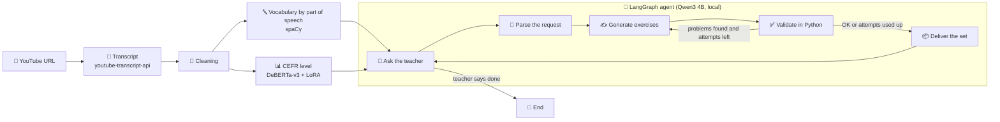

# 🎓 Teaching Assistant

### Turn an English YouTube video into level-matched exercises for your English lesson — a fine-tuned CEFR classifier plus a local AI agent


| 📊 CEFR classifier | 🤖 Agent | 🔒 Local | 📚 Exercises |
|---|---|---|---|
| Fine-tuned DeBERTa-v3 (LoRA), QWK 0.77 on held-out texts | LangGraph workflow with the teacher in the loop | Qwen3 4B through Ollama; nothing is uploaded | Four exercise types with an answer key |


## 💡 Overview

A side project built in my spare time to cover my **real need**: planning classes around video. Students now receive massive amounts of L2 input through videos, and teachers need to catch up. Finding a good video is easy; knowing its **level** and turning it into **exercises** takes time.

It works in two stages:

1. **🔍 Lexical analysis.** You give a YouTube URL. The program fetches the English transcript, lists its vocabulary grouped by part of speech (nouns, verbs…) and estimates the **CEFR level** (A1–C2) with a DeBERTa model I fine-tuned for this task.
2. **🤖 Exercise agent.** You chat with a local agent that creates exercises suited to the video and its level. You choose the type, how many and the focus, and keep asking for more sets until you say you are done.

> [!NOTE]
> **Non-commercial use.** The code is MIT, but the CEFR classifier weights are released under **CC BY-NC-SA 4.0** because of the licenses of the training data. The project as a whole is intended for non-commercial, educational use. See **License** below.

## ✨ Features

- 🎬 **From URL to analysis:** paste a YouTube link (or a video ID) and get the transcript analysed.
- 🔤 **Vocabulary by part of speech:** lemmatized words grouped with spaCy, without stop words.
- 📊 **CEFR level estimate:** A1–C2, computed over 250-word chunks and averaged.
- 🧩 **Four exercise types:** multiple choice, gap filling, true or false, and short answer.
- 🎛️ **You stay in control:** ask in free text for types, quantity, focus or a different level.
- ✅ **Automatic checks:** each set is validated in Python and regenerated if a problem is found.
- 🔁 **Keeps going until you say "done":** the agent never ends the session on its own.
- 🏋️ **Reproducible training:** the classifier training script is included.
- 🔒 **Local LLM:** exercises are generated by Qwen3 4B running on your machine.

## 🛠️ Technical Highlights

| | Area | What this project shows |
|:---|---|---|
| 🧠 | **Model fine-tuning** | LoRA (PEFT) fine-tuning of DeBERTa-v3-base for **ordinal regression** (A1 = 0 … C2 = 5), merged into a standalone model, with two encoders compared on the same test set |
| 🧪 | **Rigorous data handling** | Splits by **document before chunking** (no leakage between train and test), class balancing and caption-style augmentation |
| 📏 | **Honest evaluation** | Quadratic weighted kappa (QWK) as the main metric because CEFR levels are ordered; exact accuracy, adjacent accuracy and macro F1 are reported too |
| 🤖 | **Agentic workflow** | A LangGraph state graph with a human-in-the-loop pause. It is a fixed workflow, not a free-roaming agent: small local models are far more reliable when code controls the flow |
| 🧾 | **Structured output + validation** | Pydantic schemas with JSON-schema constrained output, plus Python checks (counts, duplicates, options, gap answers found in the transcript) and bounded retries |
| 🔤 | **Classical NLP** | spaCy POS tagging and lemmatization for the vocabulary list |
| 🔒 | **Privacy by design** | Local LLM, transcripts not stored, clean separation between code and model weights |
| ⚖️ | **Compliance** | License chain traced from datasets to the published model, and careful handling of third-party content |

**Stack:** Python · PyTorch · Transformers · PEFT (LoRA) · scikit-learn · spaCy · LangGraph · LangChain-Ollama · Pydantic · Ollama · Qwen3 · Hugging Face Hub

## 📋 Requirements

| Element | Version | Description |
|---|---|---|
| 🐍 **Python** | 3.10+ | Runtime |
| 🦙 **Ollama** | Latest | Local LLM runtime; must be running (default address `localhost`, port `11434`) |
| 🧠 **LLM** | `qwen3:4b` | About 2.5 GB; **must be downloaded manually** with `ollama pull` |
| 📊 **CEFR classifier** | [`Polender/DeBERTa-CEFR-classifier`](https://huggingface.co/Polender/DeBERTa-CEFR-classifier) | Downloaded automatically from Hugging Face on the first run (under 1 GB). CC BY-NC-SA 4.0 |
| 🔤 **spaCy model** | `en_core_web_sm` 3.8.0 | About 13 MB; installed by `requirements.txt` |
| 🤖 **langgraph** · **langchain-ollama** · **pydantic** | ≥ 0.4 · ≥ 0.3.4 · ≥ 2.0 | Agent workflow, connector to Ollama and data schemas |
| 🤗 **torch** · **transformers** · **sentencepiece** · **safetensors** · **huggingface_hub** | Latest | Running the CEFR classifier |
| 📚 **spacy** · **numpy** | spacy ≥ 3.8, < 3.9 | Vocabulary extraction; the version must match the spaCy model |
| 🎬 **youtube-transcript-api** | ≥ 1.0 | Fetches public YouTube transcripts |
| 🧮 **RAM** | 8 GB recommended | Qwen3 4B plus the classifier |
| 🎮 **GPU** | Optional | The classifier and Ollama use a GPU if one is available, otherwise the CPU |
| 💾 **Disk space** | 10 GB free | Packages (PyTorch is large) and the models |
| 🌐 **Network** | **Every run** | Needed to fetch the transcript from YouTube. The models are downloaded on the first run only |

Python packages are listed in `requirements.txt`.

**Only for training the classifier (optional):**

| Element | Description |
|---|---|
| `peft`, `datasets`, `scikit-learn`, `pandas`, `accelerate` | Not in `requirements.txt`. Install with `pip install peft datasets scikit-learn pandas accelerate` |
| 🎮 **GPU** | Strongly recommended. A few hours on a mid-range GPU for 3 epochs |

## 🚀 Get Started

1. **Install Ollama** from [ollama.com](https://ollama.com) and make sure it is running.
2. **Download the language model** (about 2.5 GB, once): `ollama pull qwen3:4b`

```bash
# 3. Clone the repository
git clone https://github.com/polendol/AgenticTeacher.git
cd AgenticTeacher

# 4. Create and activate a virtual environment
python -m venv .venv
source .venv/bin/activate          # Windows: .venv\Scripts\activate

# 5. Install the dependencies (includes the English spaCy model)
pip install -r requirements.txt

# 6. Start the assistant
python main.py
```

> [!TIP]
> The first run downloads the CEFR classifier from Hugging Face and loads it, so it takes longer. If the spaCy model fails to install with the rest, run `python -m spacy download en_core_web_sm`. The first exercise request after Ollama has been idle also takes longer while Qwen3 is loaded into memory.

## 🎮 Usage

The assistant runs in the terminal.

1. **Paste the YouTube URL** (or the 11-character video ID).
2. **Read the analysis:** the vocabulary grouped by part of speech and the CEFR level of the video.
3. **Describe the exercises you want** in free text, for example: *"4 multiple choice and 4 gap fill about phrasal verbs"*. Anything you leave out gets a default: 5 exercises each of multiple choice and gap fill, the video's level, no special focus. You can also ask for a different level.
4. **Review the set** and its answer key. The agent then asks whether you want more.
5. **Say "done"** (or "no thanks", "that's all"…) to finish.

| Exercise type | Format |
|---|---|
| 🔘 **Multiple choice** | 3–4 options; the answer is one of them |
| ✏️ **Gap filling** | A sentence from the transcript with the target word replaced by `____` |
| ✅ **True or false** | A statement whose answer is exactly "True" or "False" |
| 💬 **Short answer** | A comprehension question with a brief model answer |

> [!NOTE]
> Exercises are shown in the terminal and are not saved to disk. Copy what you need before closing the program.

## 📄 Example Output

```text
I analyzed your video!
    The video contains the following words organized by their lexical categories
    {'NOUN': ['...', '...'], 'VERB': ['...', '...'], 'ADJ': ['...'], ...}
    And its CEFR level is B1

What kind of exercises would you like? (types, how many, focus, level)
> 2 multiple choice and 2 gap fill about vocabulary

# Exercise set 1 (CEFR B1)

## Multiple Choice

1. <question>
   a) <option>
   b) <option>
   c) <option>

## Gap Fill

3. <sentence from the transcript with ____>

## Answer key

1. <answer>
...

Would you like any other exercises? Describe them, or say 'done' to finish.
> done
```

*Illustrative. The exercises are generated by a language model, so wording and quality vary between runs. If the automatic checks still find problems after the retries, the set is delivered with a note listing them.*

## ⚙️ How It Works



**Stage 1: lexical analysis.** The transcript is cleaned and run through spaCy: stop words are removed and the remaining words are lemmatized and grouped by part of speech. For the level, the transcript is split into chunks of 250 words (very short leftovers are dropped), each chunk gets a score from 0 (A1) to 5 (C2), and the scores are averaged weighted by chunk length and rounded to a CEFR level. The classifier also computes per-chunk levels and the spread between chunks (a high value means uneven difficulty); the terminal app shows only the final level.

**Stage 2: agent.** The workflow is fixed and most steps are plain Python; the model is used only where language understanding or generation is needed.

| Step | What happens |
|---|---|
| 🙋 **Ask** | The workflow pauses and asks you what you want. Stop phrases are recognised in code |
| 🧾 **Parse** | Qwen3 converts your free-text request into a structured specification (types, number, focus, level) |
| ✍️ **Generate** | One call per exercise type, constrained to a JSON schema. It sees up to 12,000 characters of the transcript, up to 20 of the most frequent words per part of speech, and the questions already used, to avoid repeating them |
| ✅ **Validate** | Python checks the number of exercises, duplicates, multiple-choice options, `____` in gap questions, that gap answers appear in the transcript and that true/false answers are valid |
| 🔁 **Retry** | If something fails, the problems are fed back and the set is regenerated (up to 2 attempts) |
| 📦 **Deliver** | A Markdown set with an answer key. The loop returns to *Ask* |

## 🏋️ Training the CEFR Classifier

The classifier is trained with the script in this repository. The published DeBERTa model was produced with this pipeline.

**Data:** the English subsets of [UniversalCEFR](https://huggingface.co/UniversalCEFR) (Imperial et al., EMNLP 2025), each with its own license.

| Dataset | License |
|---|---|
| [`cambridge_exams_en`](https://huggingface.co/datasets/UniversalCEFR/cambridge_exams_en) | CC BY-NC-SA 4.0 |
| [`elg_cefr_en`](https://huggingface.co/datasets/UniversalCEFR/elg_cefr_en) | CC BY-NC 4.0 |
| [`cefr_sp_en`](https://huggingface.co/datasets/UniversalCEFR/cefr_sp_en) | CC BY-NC-SA 4.0 |
| [`icle500_en`](https://huggingface.co/datasets/UniversalCEFR/icle500_en) | CC BY-NC 4.0 |
| [`cefr_asag_en`](https://huggingface.co/datasets/UniversalCEFR/cefr_asag_en) | CC BY-NC-SA 4.0 |
| [`readme_en`](https://huggingface.co/datasets/UniversalCEFR/readme_en) | CC BY-NC-SA 4.0 |

*Licenses as shown on the dataset pages, checked 14 Oct 2026. The datasets are not included in this repository; the script downloads them.*

**Pipeline:**

1. 📥 **Load.** Downloads every `_en` dataset of the UniversalCEFR organisation and maps each label to a number from 0 to 5 (variants such as `b1+` or `B1/B2` are mapped to their first level; unusable labels and duplicate texts are dropped).
2. ✂️ **Split by document** (80% train, 10% validation, 10% test, fixed seed, stratified when possible), *before* chunking, so pieces of one text never land in both train and test.
3. 🧱 **Chunk** every text into pieces of up to 250 words.
4. ⚖️ **Balance** the training levels by resampling each to the median class size, so rare levels (A1, C2) are not ignored.
5. 🎙️ **Augment.** 30% of the training chunks lose their casing and punctuation to imitate YouTube auto-captions. Validation and test data are untouched.
6. 🏋️ **Train** with LoRA (r = 32, α = 64) on the attention projections and dense layers, with the regression head trained fully. The best epoch by validation QWK is kept.
7. 📏 **Evaluate** on the held-out test documents and print the metrics and a confusion matrix.
8. 💾 **Merge and save.** The LoRA weights are merged into the base model, so the saved folder is a standalone model.

```bash
# Extra dependencies (not needed to run the assistant)
pip install peft datasets scikit-learn pandas accelerate

python CEFRtraining.py --model deberta --epochs 3
```

The model is saved in `models/deberta-trained-pefted-cefr`. Other options: `--model modernbert`, `--batch`, `--lr`, `--max_len`, `--full` (full fine-tuning instead of LoRA) and `--repos` (choose the datasets). To use your own model in the assistant, set `MODEL_PATH` in `functions.py` to that folder.

**Practical notes:**

- ⏱️ **Time:** a few hours on a mid-range GPU for 3 epochs; the first run is the slowest.
- 💥 **Out of memory:** lower the batch size (16 → 8) or `--max_len` (384 → 256).
- 🎯 **Precision:** bf16 is used only when the GPU supports it (RTX 30xx and newer, A100). Older cards train in fp32, which is slower. DeBERTa-v3 can be unstable in fp16, so watch for a `nan` loss if you try it.
- 📉 **Scarce levels:** if A1 or C2 have very few texts, resampling repeats them. Read the per-level counts printed at the start.

## 🧠 Model and Limitations

Two encoders were fine-tuned and compared on the same held-out test documents. DeBERTa was selected.

| Metric | DeBERTa-v3 + LoRA ✅ | ModernBERT + LoRA |
|---|---|---|
| **QWK** (main metric) | **0.771** | 0.758 |
| Test loss | **0.463** | 0.472 |
| Adjacent accuracy (within ±1 level) | 0.969 | 0.971 |
| Exact accuracy | 0.560 | 0.567 |
| Macro F1 | 0.576 | 0.589 |
| Inference speed (test set) | **12.7 samples/s** | 8.5 samples/s |

**Why DeBERTa:** CEFR levels are ordered, so the cost of an error grows with its distance from the true level. QWK penalises errors quadratically by that distance, which makes it the most appropriate primary metric. DeBERTa leads on QWK and loss and is about 1.5× faster; ModernBERT is slightly ahead on exact accuracy, macro F1 and adjacent accuracy, but by small margins.

**Models used:**

| | Component | Role |
|:---|---|---|
| 📊 | [**DeBERTa-CEFR-classifier**](https://huggingface.co/Polender/DeBERTa-CEFR-classifier) | The published model: `microsoft/deberta-v3-base` fine-tuned with LoRA and merged. Hosted on Hugging Face, not in this repository |
| 🧠 | **Qwen3 4B** (`qwen3:4b`) | Parses requests and generates exercises, locally through Ollama |
| 🔤 | **spaCy `en_core_web_sm`** | Tokenization, POS tagging and lemmatization |

> [!WARNING]
> **The CEFR level is an estimate, not an assessment.** The model gets the exact level right about 56% of the time and is within one level about 97% of the time. It is **not validated for high-stakes decisions**. Always apply your own professional judgement.

Other known limits:

- 🎙️ **Domain shift:** the classifier was evaluated on held-out texts from the training datasets, which are written English. It has not been evaluated on transcripts of spoken video, which have no punctuation and contain recognition errors. The caption-style augmentation only partly imitates them.
- 📉 **Weaker on some levels:** the macro F1 (0.58) is lower than the adjacent accuracy, which points to weaker performance on the less frequent levels.
- 📝 **Transcript quality:** only English transcripts are fetched. Automatic captions contain mistakes and sound labels such as `[Music]`, which are cleaned into ordinary words and can show up in the vocabulary. Videos without captions cannot be used.
- 🔌 **Fragile source:** transcripts come from an unofficial interface of YouTube (see Responsible Use), which can change or block requests at any time.
- 📏 **Limited context:** the agent sees the first 12,000 characters of the transcript and at most 20 words per part of speech, so long videos are covered only partially.
- 🔎 **Factual quality is not checked.** Validation covers structure and consistency, not whether a multiple-choice answer is truly correct or a true/false statement is accurate.
- 🎚️ **Level matching is prompt-based:** the model is told to write at the CEFR level, but nothing verifies that the exercises really match it.
- 🧩 **Four fixed exercise types:** adding one means updating the exercise schema, the generation prompt and the validation.
- 🎲 **Variable output:** generation uses a low but non-zero temperature, so results change between runs.
- 💉 **Untrusted content:** the transcript is inserted into the model's prompts, so a video can contain text that tries to steer the model. The agent has no tools and only produces text, which you review.

## 🔒 Privacy

- 🏠 Transcripts and exercises are processed on your computer: the LLM runs in Ollama and the classifier runs locally. Nothing is sent to a third-party AI service.
- 📡 **Network connections:** YouTube (to fetch the transcript on every run; the video ID is sent to YouTube), Hugging Face and Ollama (model downloads on the first run) and GitHub (the spaCy model during installation). After the first download, set `HF_HUB_OFFLINE=1` to stop Hugging Face Hub checks.
- 🗑️ **Nothing is stored:** transcripts and exercises are not written to disk; the conversation state lives in memory and disappears when the program ends.
- 🔌 **Remote Ollama:** if you configure Ollama to run on another machine, your text travels to that machine.
- 📦 This repository contains code only: no model weights, datasets or YouTube content.

## 🗂️ Project Structure

```text
.
├── main.py                  # Command-line entry point
├── functions.py             # Transcript, cleaning, vocabulary and CEFR classifier
├── agent.py                 # LangGraph exercise agent
├── CEFRtraining.py          # CEFR classifier training (LoRA)
├── requirements.txt         # Python dependencies
├── ThirdPartyNotices.md     # Third-party models, data and licenses
├── LICENSE                  # MIT License
└── README.md                # This file
```

The agent takes two functions, one to ask the teacher and one to show results, so the terminal can be swapped for another interface without changing the agent.

## 🗺️ Roadmap

- [ ] 📊 Evaluate the classifier on real YouTube transcripts labelled by teachers
- [ ] 🔍 Check generated exercises against the target CEFR level with the classifier
- [ ] 🌐 Web interface (the agent is already decoupled from the terminal)
- [ ] 💾 Export exercises to Markdown, Word or PDF
- [ ] 🧹 Remove caption noise such as `[Music]` before analysis
- [ ] 🧩 More exercise types
- [ ] 🐳 Dockerfile and Docker Compose with Ollama
- [ ] 📌 Pinned dependency versions for reproducible builds
- [ ] ✅ Automated tests and CI

## ⚠️ Responsible Use

> [!CAUTION]
> This tool fetches public YouTube transcripts for personal and educational use. It does not store or redistribute them. Transcripts belong to their creators, and exercises generated from them should not be republished.
>
> The transcripts are obtained through an **unofficial library** that uses an undocumented part of YouTube, not the official YouTube API. YouTube's Terms of Service restrict automated access to the service, so **you are responsible for checking and following them**.
>
> Review every exercise before using it in class: the model can produce wrong answers. Do not use the CEFR estimate for high-stakes decisions.

## ⚖️ License

The **code** in this repository is released under the **[MIT License](LICENSE)**. Copyright (c) 2026 Paulina Olender.

> [!IMPORTANT]
> The CEFR classifier hosted on Hugging Face is **not MIT**. It is released under **CC BY-NC-SA 4.0** (non-commercial) because of the licenses of its training data, so this project as a whole is intended for **non-commercial use**. If you retrain with these datasets, check their licenses, including the attribution and ShareAlike conditions, before publishing your model.

Third-party components keep their own licenses, listed in [ThirdPartyNotices.md](ThirdPartyNotices.md).

> This software is provided "as is", without warranty of any kind. This is an independent project, not affiliated with or endorsed by YouTube, Google, Microsoft, Alibaba (Qwen), Hugging Face, the UniversalCEFR authors, Explosion, LangChain or Ollama. YouTube is a trademark of Google LLC. All product names and trademarks belong to their respective owners.

### 📜 Third-Party Licenses

| Component | Role | License | Notes |
|---|---|---|---|
| [Polender/DeBERTa-CEFR-classifier](https://huggingface.co/Polender/DeBERTa-CEFR-classifier) | CEFR classifier | ⚠️ **CC BY-NC-SA 4.0** (non-commercial) | Hosted on Hugging Face, not in this repository. Derived from `deberta-v3-base` and trained on non-commercial datasets |
| [microsoft/deberta-v3-base](https://huggingface.co/microsoft/deberta-v3-base) | Base model | MIT | |
| [answerdotai/ModernBERT-base](https://huggingface.co/answerdotai/ModernBERT-base) | Candidate compared during training | Apache 2.0 | Only used in the comparison; its fine-tuned model is not published |
| [UniversalCEFR](https://huggingface.co/UniversalCEFR) English subsets | Training data | ⚠️ CC BY-NC-SA 4.0 or CC BY-NC 4.0, depending on the dataset (see the table above) | Not included in this repository; downloaded by the training script |
| [Qwen3 4B](https://ollama.com/library/qwen3) (`qwen3:4b`) | Exercise generation | Apache 2.0 (as shown on the Ollama library page, checked 14 Oct 2026) | Not included; downloaded by each user through Ollama |
| [Ollama](https://github.com/ollama/ollama) | Local LLM runtime | MIT | |
| [spaCy](https://github.com/explosion/spaCy) | NLP library | MIT | |
| [`en_core_web_sm`](https://spacy.io/models/en#en_core_web_sm) 3.8.0 | English spaCy pipeline | MIT (as stated in the package metadata, checked 14 Oct 2026) | Trained on OntoNotes 5 (licensed by Explosion) and WordNet 3.0 (WordNet License). Installed from the official release |
| [youtube-transcript-api](https://github.com/jdepoix/youtube-transcript-api) | Transcript retrieval | MIT | Uses an undocumented YouTube interface; see Responsible Use |
| [LangGraph](https://github.com/langchain-ai/langgraph) · [langchain-ollama](https://github.com/langchain-ai/langchain) · [Pydantic](https://github.com/pydantic/pydantic) | Agent workflow, Ollama connector, schemas | MIT | |
| [Transformers](https://github.com/huggingface/transformers) · [PEFT](https://github.com/huggingface/peft) · [Datasets](https://github.com/huggingface/datasets) · [SentencePiece](https://github.com/google/sentencepiece) · [safetensors](https://github.com/huggingface/safetensors) · [huggingface_hub](https://github.com/huggingface/huggingface_hub) | Model loading, fine-tuning and data | Apache 2.0 | |
| [PyTorch](https://github.com/pytorch/pytorch) · [NumPy](https://github.com/numpy/numpy) · [scikit-learn](https://github.com/scikit-learn/scikit-learn) · [pandas](https://github.com/pandas-dev/pandas) | Numerics, metrics and data handling | BSD-style | Linux wheels of PyTorch install NVIDIA CUDA runtime packages under NVIDIA's own terms |

> [!NOTE]
> The training script downloads **every** `_en` dataset of the UniversalCEFR organisation at run time. The table above lists the six that exist at the time of writing; if more are added, check their licenses before training or publishing a model. This is not legal advice.

## 🙏 Acknowledgments

Thanks to the **UniversalCEFR** authors and the creators of the original datasets, to **Microsoft** for DeBERTa, to the **Qwen** team, to **Explosion** for spaCy, to the **Hugging Face**, **LangChain** and **Ollama** teams, and to the maintainers of **youtube-transcript-api**.

## 📚 Citation

If you build on this work, please cite UniversalCEFR **and the original dataset papers** (listed on each dataset page), and the underlying models:

- Imperial, J. M. et al. *UniversalCEFR: Enabling Open Multilingual Research on Language Proficiency Assessment.* EMNLP 2025. [arXiv:2506.01419](https://arxiv.org/abs/2506.01419)
- He, P., Gao, J. and Chen, W. *DeBERTaV3: Improving DeBERTa using ELECTRA-Style Pre-Training with Gradient-Disentangled Embedding Sharing.* [arXiv:2111.09543](https://arxiv.org/abs/2111.09543)
- Hu, E. J. et al. *LoRA: Low-Rank Adaptation of Large Language Models.* [arXiv:2106.09685](https://arxiv.org/abs/2106.09685)
- Warner, B. et al. *Smarter, Better, Faster, Longer: A Modern Bidirectional Encoder (ModernBERT).* [arXiv:2412.13663](https://arxiv.org/abs/2412.13663)
- Qwen Team. *Qwen3 Technical Report.* [arXiv:2505.09388](https://arxiv.org/abs/2505.09388)

## 👤 Author

**`Paulina Olender`** — NLP / Machine Learning

Feedback, issues and suggestions are welcome. If this tool is useful to you, a ⭐ is appreciated.


